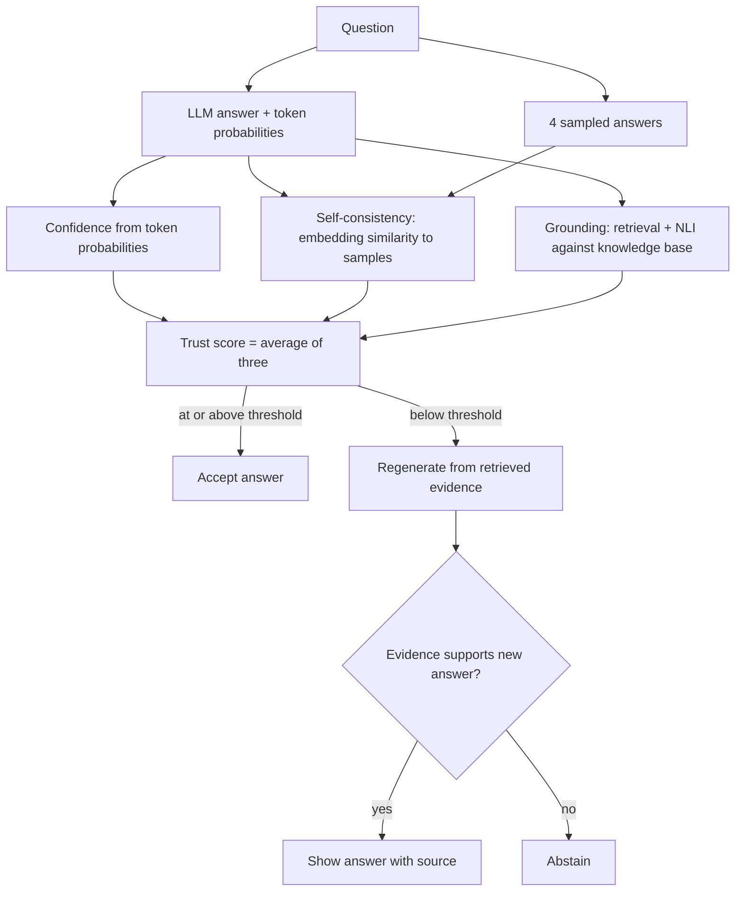

# Hallucination Detection and Mitigation in LLMs

A B.Tech CSE mini project. The pipeline scores how trustworthy an LLM answer is using three signals, and triggers a fix (regenerate from evidence, or abstain) when the score is low.

## Architecture



## Setup

```
python -m venv venv
venv\Scripts\activate
pip install torch --index-url https://download.pytorch.org/whl/cpu
pip install -r requirements.txt
```

## Run

```
streamlit run app.py                 # demo
python src/evaluate.py 0 100         # score questions 0-100 (use a GPU for more)
python src/merge_results.py          # merge chunks
python src/analyze_merged.py         # AUROC and ablation
python src/paired_test.py            # paired bootstrap
python src/calibrate.py              # ECE before/after Platt scaling
python src/latency.py                # cost of each component
python src/mitigation_test.py loo 0 100
```

Set `LLM_MODEL` to change the model (default `Qwen/Qwen2.5-0.5B-Instruct`; the main results use `Qwen/Qwen2.5-1.5B-Instruct`).

## Results (TruthfulQA, first 300 questions, Qwen2.5-1.5B-Instruct)

| Method | AUROC | 95% CI |
|---|---|---|
| Consistency | 0.695 | 0.61 to 0.77 |
| Grounding | 0.693 | 0.60 to 0.77 |
| Confidence | 0.680 | 0.60 to 0.76 |
| Average of all three | 0.755 | 0.67 to 0.83 |

- Calibration (Platt scaling, 5-fold CV): ECE of the trust score fell from 0.372 to 0.059.
- Latency (0.5B model, laptop CPU): the full pipeline is about 5.4x slower than a plain answer. The four extra samples are about 78% of the total time.
- Mitigation, 100 questions, strictest threshold: in the realistic leave-one-out setting, hallucinations shown to the user fell from 79 to about 38, at the cost of 46 abstentions.

## Limitations

- Labels are automatic (NLI against TruthfulQA references). A hand check of 100 rows found 27 disagreements, mostly correct answers marked as hallucinated, so all rates are approximate.
- The knowledge base is built from TruthfulQA reference answers, so grounding is easier than with a real source. The leave-one-out test removes the question's own references.
- One small model and one benchmark.
- The paired test shows the combined score is not clearly better than consistency alone.